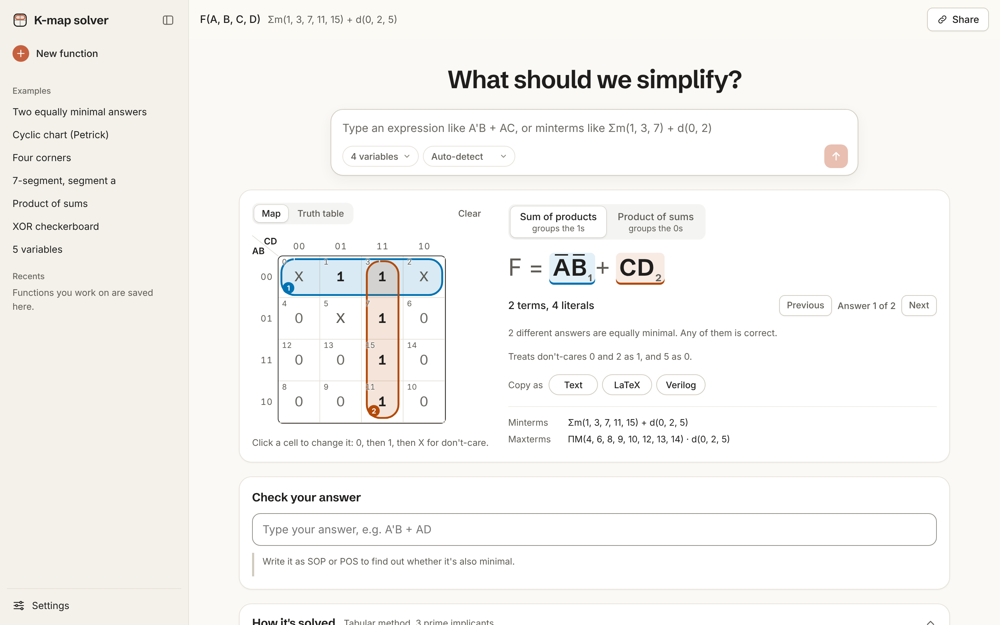
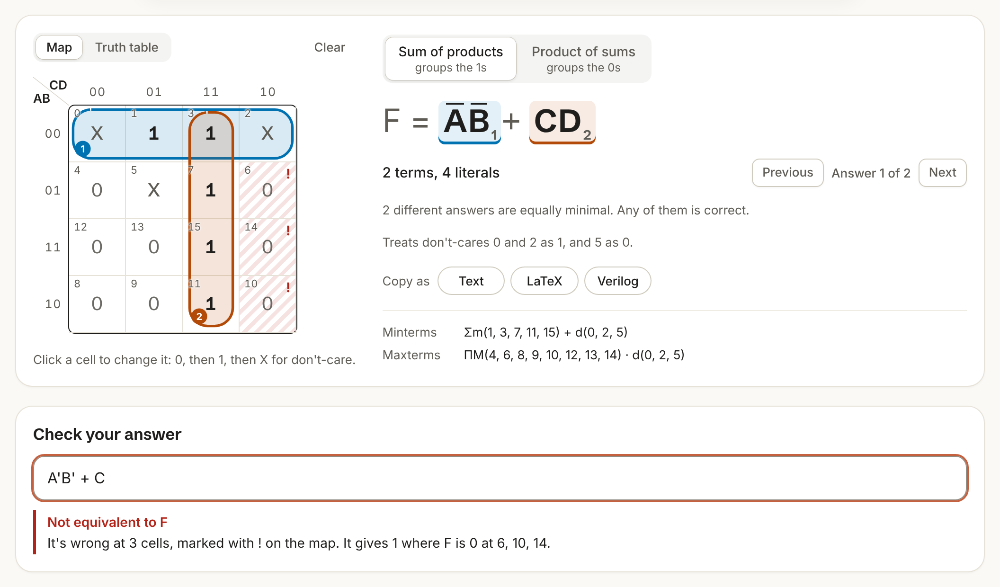
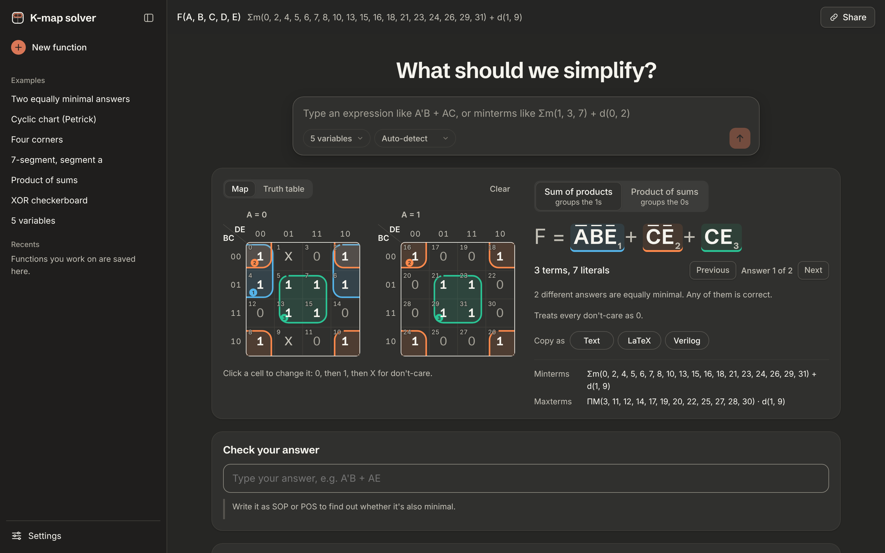
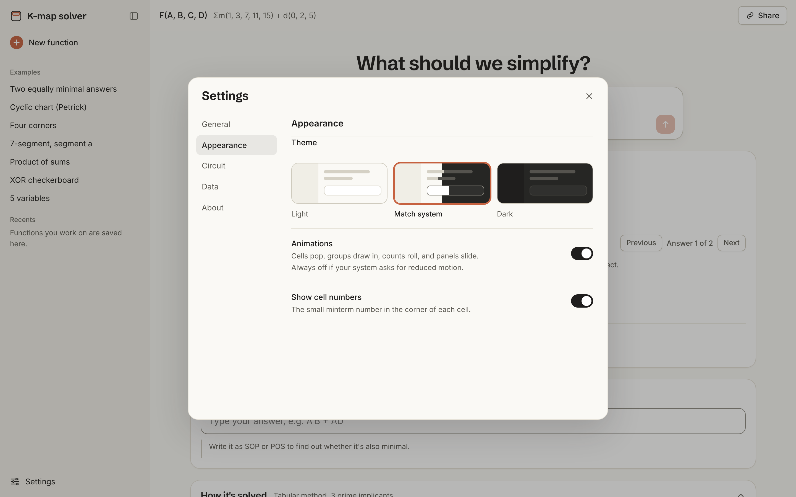
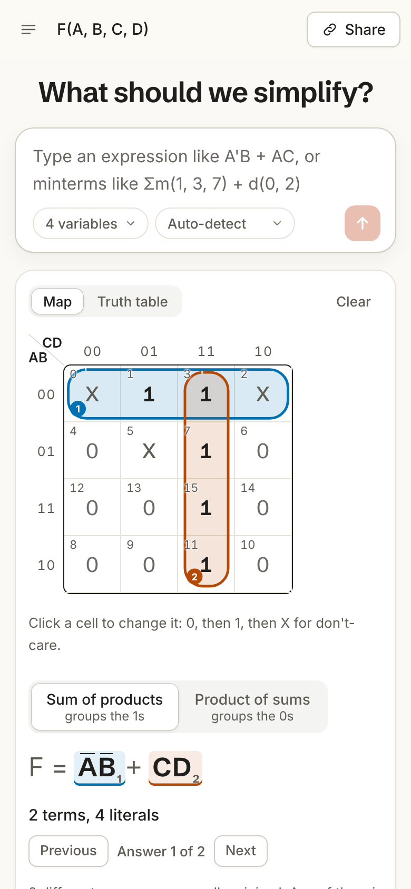
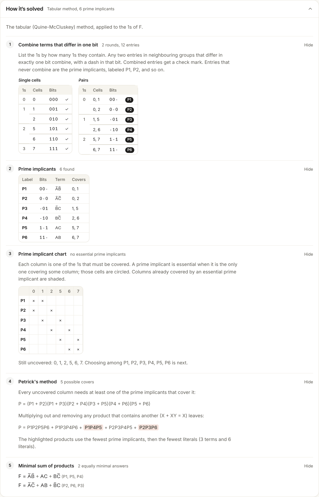
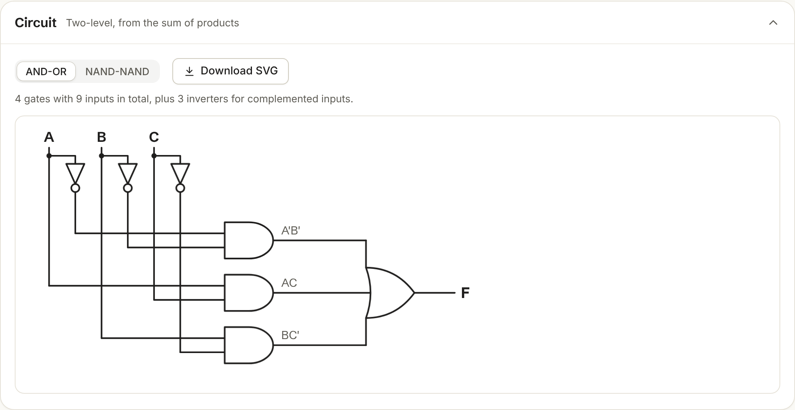

# K-Map Solver

[](https://github.com/BontoJamesRod/kmap-solver/actions/workflows/ci.yml)


A Karnaugh map solver for 2 to 6 variables. It finds **every** minimal answer, draws the groups on the map the way you would by hand, explains the tabular method step by step, checks your own answer, and draws the circuit.

**Live site: https://bontojamesrod.github.io/kmap-solver/**



## Why another K-map solver?

Most online solvers show one answer and no reasoning, stop at 4 variables, and you have to trust them. Some published answers are simply wrong (see [docs/RESEARCH.md](docs/RESEARCH.md) for an example from a tutorial answer key). This one is built around three ideas:

1. **Proven correct, not just plausible.** The solver is tested against every possible Boolean function of up to 4 variables, and against an independent brute-force search for minimality ([details](#how-correctness-is-checked)).
2. **All the right answers.** Many functions have several equally minimal answers. If yours differs from a tool's single answer, that doesn't mean it's wrong, so this solver lists every one and lets you step through them on the map.
3. **Shows the work.** The same steps you'd write in an exam: grouping by number of 1s, combining, prime implicants, the prime implicant chart, essential prime implicants, and Petrick's method.

## Features

- **2–6 variables.** 5 and 6 variables are drawn as overlaid 4×4 maps, and groups that span maps are shown on every map they touch.
- **One box for any input.** Type an expression (`A'B + AC'D`) or a list (`Σm(1,3,7) + d(0,2)`, `ΠM(0,4)`) into the composer and press Enter. It detects which one you mean and adds variables if a list needs them. You can also click the map or edit the truth table.
- **Minimal SOP and POS.** Product of sums groups the 0s, exactly as in class.
- **Groups drawn like highlighter loops**, including wrap-around and corner groups, each with its own color-blind-safe color and a number.
- **Matches your textbook.** Rename the variables (`w x y z`), and switch 3-variable maps between `A × BC` and `AB × C`.
- **Check your answer.** It tells you whether your answer is equivalent, whether it's minimal, and which cells it gets wrong.
- **Circuit diagram** as AND-OR or NAND-NAND (OR-AND or NOR-NOR for POS), downloadable as SVG.
- **Copy the answer** as text, LaTeX, or a Verilog `assign` statement. Share the exact function with a link.
- **Workspace like a chat app:** textbook examples and your *Recents* in a sidebar, with each function titled by its answer, plus a *Settings* dialog for variable names, map layout, theme, display, and default gate style.
- **Motion with a purpose:** cells pop when they turn to 1, groups draw themselves in, counts roll, toggles slide, the answer staggers in term by term, the circuit wires itself, and the theme spreads out from where you clicked. One switch in Settings turns it all off, and it stays off if your system asks for reduced motion.
- **Accessible:** fully keyboard-operable and screen-reader labeled, with light and dark themes. Works on phones.
- **No backend:** nothing you type leaves your browser.

| | |
| --- | --- |
|  |  |
|  |  |

## Step by step





## Input syntax

The composer accepts lists as well as expressions:

| Input | Example |
| --- | --- |
| Minterms with don't-cares | `Σm(1, 3, 7) + d(0, 2)`, `m(1 3 7) d(0 2)`, `1, 3, 5-7` |
| Maxterms | `ΠM(0, 4) · d(2)`, `M(0, 4)` |

Expressions use these operators:

| Operation | You can type |
| --- | --- |
| NOT | `A'` `~A` `!A` `¬A` `NOT A` `(A+B)'` |
| AND | `AB` `A*B` `A·B` `A&B` `A.B` `A AND B` |
| OR | `A+B` `A\|B` `A OR B` |
| XOR | `A^B` `A⊕B` `A XOR B` |
| Constants | `0` `1` |

Precedence from highest is NOT, AND, XOR, OR. A variable is one letter followed by optional digits (`A`, `x`, `x1`), so `AB` means A AND B.

## How correctness is checked

| Check | Coverage |
| --- | --- |
| The answer is equivalent to the function (ignoring don't-cares) | All 65,536 functions of 4 variables, all 6,561 functions of 3 variables with don't-cares, 20,000 random 4-variable functions with don't-cares, 3,000 at 5 variables, and 500 at 6 |
| The answer is minimal, and no minimal answer is missing | Compared with an independent brute-force search over *every* implicant, for all 3-variable functions with don't-cares and 1,500 random 4-variable ones |
| Two different algorithms agree | The exact branch-and-bound search and Petrick's method must return the same answers |
| The steps are right | The prime implicant list, essentials, and Petrick expansion are checked independently |
| The tests can catch bugs | Deliberately broken versions of the engine were run to confirm these tests fail |
| Speed | Every function, including hard symmetric 6-variable ones, solves in under 0.5 s |

In total there are 143 engine tests, and 31 browser tests cover the main flows, phone widths, and automated accessibility scans in both themes, including the settings dialog and the phone drawer.

## Run it locally

Requires Node.js 22 or newer.

```bash
git clone https://github.com/BontoJamesRod/kmap-solver
cd kmap-solver
npm install
npm run dev
```

| Command | What it does |
| --- | --- |
| `npm test` | Engine tests, including the exhaustive checks (about 20 s) |
| `npm run e2e` | Browser tests (run `npx playwright install chromium` once first) |
| `npm run verify` | Everything: types, lint, tests, build, browser tests |

## How it's built

- **TypeScript + React + Vite**, deployed to GitHub Pages by GitHub Actions on every push to `main`.
- **Design** takes its feel from the Claude web app: warm neutrals and a composer-style input. Headings, answers, and the map are set in Schibsted Grotesk, interface text in Inter, and bit patterns in B612 Mono. Name, logo, and fonts are its own.
- **`src/engine/`** holds all the logic in pure TypeScript with no UI code: Quine-McCluskey, the exact cover search, Petrick's method, the expression parser, map geometry, and circuit layout. **`src/ui/`** only renders it. Lint rules enforce the split.
- Docs written before the code:
  - [Research](docs/RESEARCH.md): existing tools, algorithms, textbook conventions, common student mistakes
  - [Requirements](docs/REQUIREMENTS.md): every feature, with the tests that prove it
  - [Architecture](docs/ARCHITECTURE.md)
- **Set up for Claude Code:** [`CLAUDE.md`](CLAUDE.md) holds the project rules, plus two commands in `.claude/commands/`: `/verify` runs every check, and `/feature` adds a feature the project's way (requirement, then tests, then code).

## License

MIT, see [LICENSE](LICENSE).
